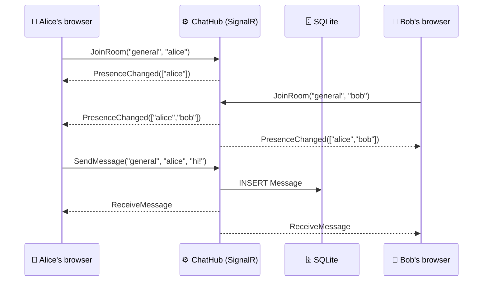

<div align="center">

# 💬 PingRoom

### Real-time chat that actually feels real-time.

*Type a message. Watch it land on someone else's screen before you blink.*


**[🚀 Live Demo](https://chat-app-bvgbfcdtfcbncjfu.malaysiawest-01.azurewebsites.net/)** · **[🎬 Demo GIF](#-see-it-in-action)** · **[🧠 Design Decisions](#-design-decisions)**

</div>

---

## 🎬 See it in action


> 💡 **Try it yourself:** open the live demo in two browser windows, join the same room with different names, and start typing. Watch the *"is typing..."* indicator and the online list react instantly.
>
> ⏳ Hosted on a free tier, so the first load can take up to 30 seconds while the server wakes up.
> If Chrome shows a warning on the shared Azure domain, click **Details → visit site**, or open it in another browser. It's my own portfolio app.

---

## ✨ What it does

| | Feature | How it works |
|---|---|---|
| ⚡ | **Instant messages** | SignalR pushes every message to everyone in the room over WebSockets |
| 🚪 | **Multiple rooms** | Join `general`, `random`, or invent your own. Rooms are SignalR groups |
| 🟢 | **Live presence** | See who's online, updated the moment someone joins or leaves |
| ✍️ | **Typing indicator** | "raghava is typing..." appears for everyone else, throttled to avoid spam |
| 📜 | **Message history** | The last 50 messages load from the database when you enter a room |
| 🛡️ | **Safe by default** | Empty and over-length messages are rejected. Text is rendered with `textContent`, so no XSS |

---

## 🧩 How it works



**The cast:**

- 🎛️ **`ChatHub`** is the traffic controller: join, send, typing, disconnect.
- 🧠 **`PresenceTracker`** remembers who's online in a thread-safe `ConcurrentDictionary`.
- 💾 **`ChatDbContext`** stores messages, with a composite index on `(Room, SentAt)` so history loads fast.
- 🌐 **A minimal API endpoint** serves the last 50 messages per room.

---

## 🛠️ Tech stack

```
Backend   ASP.NET Core · SignalR · Minimal APIs
Data      Entity Framework Core · SQLite · Migrations (applied on startup)
Frontend  Vanilla HTML/CSS/JS · @microsoft/signalr client
Testing   xUnit
DevOps    GitHub Actions (CI + deploy) · Azure App Service
```

---

## 🧠 Design decisions

<details>
<summary><b>Why is presence in memory but messages in a database?</b></summary>

Presence is temporary: it's only true while a connection is open, so it's fast to keep in memory and pointless to persist. Messages have to survive restarts, so they live in the database.
</details>

<details>
<summary><b>Why SQLite?</b></summary>

It's perfect for a single-instance demo with zero setup. Moving to Azure SQL or PostgreSQL only means changing the provider and connection string, because EF Core abstracts the rest.
</details>

<details>
<summary><b>Why does a user count once, even with two tabs open?</b></summary>

`UsersIn()` returns distinct names. If you close one tab, you stay online until your last connection drops. This is covered by unit tests.
</details>

<details>
<summary><b>How is XSS prevented?</b></summary>

Messages are inserted into the page with `textContent`, never `innerHTML`, so `<script>` in a message is shown as plain text.
</details>

<details>
<summary><b>What would break if I ran multiple servers?</b></summary>

Each server only knows its own connections, so messages wouldn't cross between instances. The fix is a **Redis backplane** for SignalR, and presence would move into Redis as well.
</details>

---

## 🚧 Known limitations & roadmap

- [x] Rooms, presence, typing indicators, history
- [x] Unit tests and CI
- [x] Deployed to Azure
- [ ] 🔐 **JWT authentication.** Right now the client sends its own username, so it can be spoofed. The plan is to read the name from `Context.User` on the server.
- [ ] 💌 Private messages
- [ ] ⚛️ Blazor client
- [ ] 🧱 Redis backplane for scaling out

---

## 🏃 Run it locally

```bash
git clone https://github.com/raghava503/ChatApp.git
cd ChatApp
dotnet run
```

Open **http://localhost:5073** in two windows and say hi to yourself. 👋

The SQLite database is created and migrated automatically on first run.

## 🧪 Run the tests

```bash
dotnet test ChatApp.Tests
```

Tests cover `PresenceTracker`: single user, duplicate connections, removal, unknown connections, room isolation, and sorting.

## 🔄 CI/CD

Every push to `main` triggers GitHub Actions to **build → test → deploy** to Azure App Service.

---

## 📚 What I learned building this

- How SignalR picks a transport (WebSockets → Server-Sent Events → long polling) and why groups make rooms easy.
- Why shared state needs thread-safe collections when many connections hit it at once.
- Running EF Core migrations at startup, and why that needs care with multiple instances.
- Deploying to Azure App Service: persistent `/home` storage, app settings, and CI/CD with publish profiles.
- Debugging real deployment problems, from a missing `DbContext` at design time to a Google Safe Browsing false positive.

---

<div align="center">

**Built by [Raghava](https://github.com/raghava503)** · Fresher full-stack .NET developer

*If you read this far, I'd love to chat. In real time, of course.* 😄

⭐ Star the repo if it helped you!

</div>
